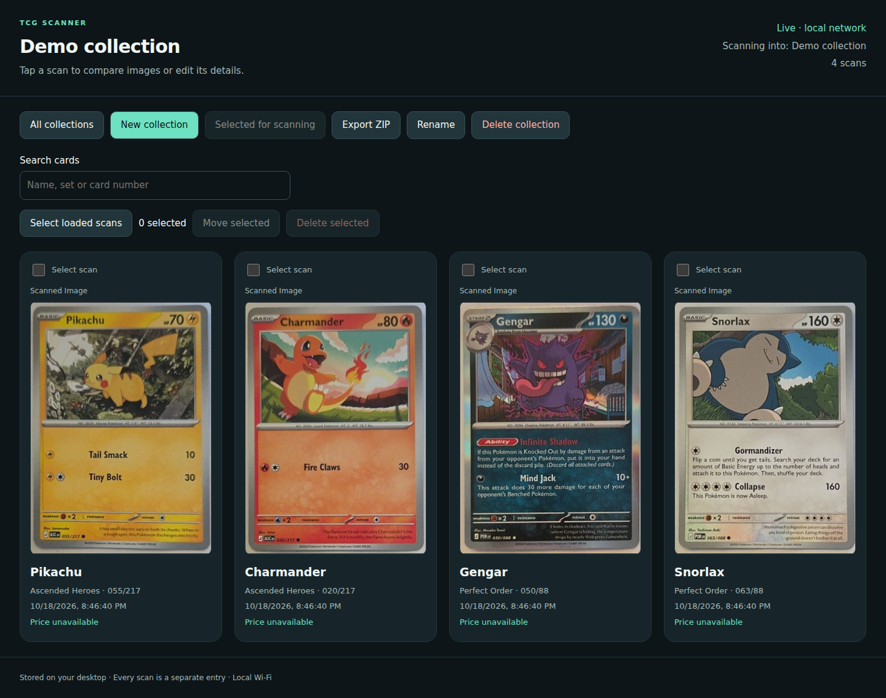
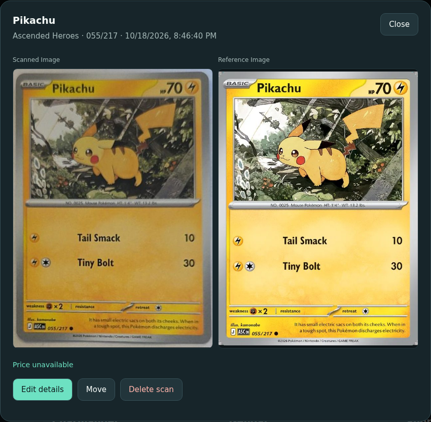

# pokemon-tcg-scanner

Scan Pokémon cards with your Android phone and organize them into collections.
Your computer identifies each card over your local network.

- **Scan and save** cards directly to a collection.
- **Manage your collection** in a browser: search, edit, and review uncertain matches.
- **Export your cards** as a ZIP with JSON metadata and the original scanned images.

[Quick start](#quick-start) · [Screenshots](#screenshots) · [Using the scanner](#using-the-scanner) ·
[Configuration](#configuration-and-storage) · [Models and dataset](#models-and-dataset) ·
[Android builds](#building-the-android-app) · [Training](#training-your-own-detector) ·
[Development](#development-and-testing)

## Screenshots

The web interface with a demo collection using photos from the included dataset.



<details>
<summary>Card details: compare the saved scan with the catalog image</summary>



</details>

## How a scan works

1. **Find the card.** YOLOv8n crops the card on your phone and sends it to your computer.
2. **Match the artwork.** DINOv2 Small and FAISS find visually similar cards.
3. **Read the collector number.** RF-DETR Small locates the number, and PaddleOCR reads it.
4. **Identify the card.** The server combines artwork and collector-number matches
   to distinguish cards across sets.
5. **Save the result.** Confident matches save to your collection. Uncertain matches
   retry or can be reviewed in the browser.

Artwork matching and number recognition run in parallel on your computer.
The trained collector-number model is included.
[Model setup](docs/MODELS.md) · [Detailed matching process](desktop/HYBRID_SCANNING.md)

## What you need

- **Computer:** Windows x64, Linux x64, or macOS 14+ on Apple silicon,
  with Python 3.11/3.12. NVIDIA GPU acceleration is available on Windows and Linux x64;
  CPU mode runs the same identification pipeline.
- **Git LFS:** required to clone the included model and training images.
- **Phone:** Android 8.0+ on the same private network as your computer.
- **Android app:** download the signed APK from [GitHub Releases](https://github.com/remote-event/pokemon-tcg-scanner/releases/latest).
  JDK/Android SDK are only needed if you choose to build it yourself.

Internet is needed for setup and card catalog downloads. Identification runs
locally; card artwork and price lookups may still use the internet.

## Quick start

### 1. Set up the server

Install [Git LFS](https://git-lfs.com/) first, then run in PowerShell, Command Prompt,
or your Linux/macOS terminal. Use `python3` if your system has no `python` command:

```bash
git lfs install
git clone https://github.com/remote-event/pokemon-tcg-scanner.git
cd pokemon-tcg-scanner
git lfs pull

python scanner.py setup
python scanner.py models
python scanner.py sync

python scanner.py server
```

Setup selects NVIDIA CUDA when available, otherwise CPU. Use
`python scanner.py setup --device cpu` to force CPU mode or
`python scanner.py setup --device cuda` to require NVIDIA acceleration. CUDA setup
requires a compatible driver. The first catalog sync can take a while and includes
Scarlet & Violet onward by default. [Platform details](docs/PLATFORMS.md).

Open the address printed by the server (`http://<computer-ip>:8765`) in your
browser and create a collection. Keep this terminal running.

[Configuration and storage](#configuration-and-storage) ·
[WSL and connection help](docs/TROUBLESHOOTING.md)

### 2. Install the Android app

[Download the latest APK](https://github.com/remote-event/pokemon-tcg-scanner/releases/latest/download/pokemon-tcg-scanner.apk)
and open it on your phone. Allow installation from your browser or file manager
when Android asks. No GitHub sign-in or build tools are needed.

The APK includes the phone detector. [Release notes and checksums](https://github.com/remote-event/pokemon-tcg-scanner/releases/latest)
are available with each version. Updates use the same release key. Existing local
debug installs use a different signing key; see
[installation details](#android-updates).

[Build the app yourself](#building-the-android-app)

### 3. Scan a card

Open the app, allow camera access, and select your collection at the bottom.
The app finds the server automatically; you can also enter its IP in settings.
Hold one card steady in view. Confident matches save automatically; uncertain
matches can be reviewed in the web interface.

Next time, just run `python scanner.py server` and open the app.

## Using the scanner

Choose a collection from the bottom selector and hold one card steady. Confident
matches save automatically. Tap the result for larger artwork, pricing, and image
comparison. Pause scanning or toggle the flashlight using the camera controls.

Use **Manage collections** to create or organize collections. The browser also
supports reviewing uncertain matches, searching, editing, moving, and exporting scans.

- **Scan time:** total time from the first usable frame to the saved result on your phone.
- **Processing time:** server recognition time, excluding storage and network transfer.
- **Sound and vibration:** enabled through app preferences and Android settings.
  They fire for newly saved scans and follow your phone's sound settings.

### Collection exports

**Export ZIP** downloads `collection.json` and an `images/` folder. Each entry in
`cards` includes `name`, `set`, `number`, and `image_path` relative to the ZIP.
Numbers remain strings to preserve formatting. The JSON also includes collection
details, timestamps, and verification status.

Exports include the entire collection regardless of search or pagination. Shared
images appear once; missing images have `image_path: null` and contribute to
`missing_image_count`. ZIP import is not currently supported.

### Android updates

Release APKs include the phone detector and use a persistent signing key, so later
releases update earlier release installs. The display name is **pokemon-tcg-scanner**;
the application ID remains `dev.tcg.scanner` for compatibility.

A locally built debug app has a different signature and cannot be updated in place
with the release APK. Preserve device-only data before changing installations.
Collections are stored on the server in `data/scan-history/`.

[GitHub Releases](https://github.com/remote-event/pokemon-tcg-scanner/releases)
includes checksums, the public signing fingerprint, and
`pokemon-tcg-scanner-sources.zip` containing matching source, the original phone
checkpoint, and license notices. Development builds in
[Actions](https://github.com/remote-event/pokemon-tcg-scanner/actions/workflows/android-apk.yml)
require GitHub sign-in and expire after 90 days. Version tags automatically publish
release APKs; see the [maintainer release guide](docs/RELEASING.md).

## Configuration and storage

`desktop/config.toml` contains portable defaults. Setup creates ignored
`desktop/config.local.toml`, which takes precedence. `--config` or `TCG_CONFIG`
selects another file; `TCG_<SETTING>` environment variables override file settings,
and CLI options override those. Paths resolve relative to the configuration file,
except collector weights, which resolve relative to `data_dir`.

| Path | Contents |
| --- | --- |
| `data/metadata.sqlite3` | Catalog metadata and reference vectors |
| `data/indexes/` | Rebuildable FAISS index |
| `data/scan-history/` | Collections, scanned photos, and related caches |
| `artifacts/` | Local training runs, benchmarks, and reports |

Back up the **entire scan-history directory while the server is stopped**.
Collection ZIP exports are not a full backup. Local settings, scans, caches,
and training outputs are excluded from Git.

For a smaller first catalog, run `python scanner.py sync --set sv01`. The default
starts with Scarlet & Violet; configure `since` or use explicit `--set` options
for other sets. Model or preprocessing changes may require rebuilding embeddings;
model revisions and image-processing dependencies are pinned to keep them consistent.

```bash
python scanner.py doctor
python scanner.py status
python scanner.py server --host <private-ip> --port 8765
# Detailed troubleshooting:
python scanner.py server --log-level debug --access-log
```

`doctor` checks installation without downloading models or modifying databases.
Normal logs show startup, connections, accepted scans, and errors; HTTP access
logs are off by default. `/health` reports compute devices, model readiness, and
inference counters. Failed OCR workers are reported as degraded while visual
matching remains available. Restart the server after changing models.

The server accepts private network addresses and rejects wildcard/public binds.
It has no internet-facing authentication; use a trusted private network.
See [connection troubleshooting](docs/TROUBLESHOOTING.md).

### Catalog commands

Run `python scanner.py cli <command>` from the repository root:

| Command | Purpose |
| --- | --- |
| `sync [--set sv01]` | Discover cards and create missing embeddings |
| `embed --existing` | Embed existing metadata without catalog discovery |
| `status` | Inspect metadata and embedding counts |
| `verify` / `rebuild-index` | Validate or rebuild FAISS from stored vectors |
| `identify /path/card.jpg` | Identify a saved photo |
| `evaluate /path/card.jpg --expected-card sv01-001` | Produce a labeled evaluation report |
| `scan` | Interactive photo identification with a resident model |

Use `--help` for options. Legacy image cleanup requires `--confirm-delete` and
never runs during setup or startup.

## Models and dataset

Setup prepares the models for artwork matching and collector-number recognition.
[Model preparation details](docs/MODELS.md).

| Model | Purpose | Input |
| --- | --- | --- |
| YOLOv8n card-corner detector | Crop and straighten the card on Android | 480 × 480 ONNX export |
| DINOv2 Small | Create artwork embeddings for FAISS search | Cropped card |
| RF-DETR Small | Locate the collector-number region on the server | 512 × 512 grayscale/stretch |
| `en_PP-OCRv5_mobile_rec` | Recognize the collector number with PaddleOCR | Collector-number crop |

### Included collector-number checkpoint

[`models/collector-number/rfdetr-small.pth`](models/collector-number/rfdetr-small.pth)
is the project's trained number detector, included through Git LFS and ready to use.
Setup verifies it automatically. If the file contains only a Git LFS pointer,
run `git lfs pull`.

See its [metadata](models/collector-number/rfdetr-small.json),
[checksums](models/collector-number/SHA256SUMS),
[training parameters](models/collector-number/training.json), and
[Apache-2.0 license](models/collector-number/LICENSE-APACHE.txt).
The included file is for inference; resuming training requires a full training checkpoint.

### Included training dataset

[`training/collector_numbers/dataset/`](training/collector_numbers/dataset/)
contains 500 original 630 × 880 card images and 501 COCO bounding boxes. Labels
cover the full collector number, including its denominator where present; they
are bounding boxes, not character transcripts.

- `*.jpg`: original images stored through Git LFS.
- `_annotations.coco.json`: image records and visually reviewed boxes.
- `grouping.json`: filenames and card IDs for grouping repeated cards.
- `splits.json`: original image hashes, preprocessing, and split assignments.

The seeded 70/20/10 split is **350 training / 100 validation / 50 test**, with seed
42. Repeated card identities and exact duplicate images stay in one split.
Original filenames and bytes are retained for verification. Prepared copies and
new checkpoints go under ignored `artifacts/`.

This dataset covers a limited selection of cards and is not a comprehensive
benchmark of sets, languages, printings, lighting, or cameras. Pokémon artwork
and trademarks retain their owners' rights; the MIT code license does not
relicense the images. See [third-party notices](THIRD_PARTY_NOTICES.md).

## Building the Android app

Use the release APK for normal installation. Building requires JDK 17 and Android
SDK 36, with `JAVA_HOME` and `ANDROID_HOME` set. After backend setup:

```bash
python scanner.py pip install -r desktop/requirements/requirements-export.txt
python scanner.py models --android
python scanner.py android
adb install -r mobile/android/app/build/outputs/apk/debug/app-debug.apk
```

The launcher selects the native Windows or Unix Gradle wrapper. Model export uses
the pinned upstream four-corner YOLO checkpoint without training. Generated ONNX
weights stay local; the build rejects missing detector assets.

The **Checks** workflow compiles and runs unit tests. **Android APK** exports the
model, tests, signs, verifies, and packages installable APKs. For distribution,
follow [release signing setup](docs/RELEASING.md#android-apk-workflow) and preserve
[Android notices](mobile/android/THIRD_PARTY_NOTICES.md). Keep the application ID
and signing key stable for updates.

<details>
<summary>Building through WSL with Windows Android Studio</summary>

Set the SDK path in ignored `mobile/android/local.properties`, ensure `cmd.exe`
is on PATH, and run:

```bash
TCG_WINDOWS_JAVA_HOME='C:\Program Files\Android\Android Studio\jbr' bash mobile/build.sh
```

When using Windows adb, select its SDK executable and pass a Windows APK path
(`wslpath -w` converts paths). `ADB` selects the executable for test scripts.
Native Windows, Linux, and macOS builds do not require this WSL wrapper.

</details>

## Training your own detector

Training is optional and requires NVIDIA CUDA. Normal installation uses the
included checkpoint. New training runs do not deploy or replace server models.

<details>
<summary>Prepare the dataset, train RF-DETR, and save graphs</summary>

### Training environment

Training requires NVIDIA CUDA. The commands below show Linux/WSL setup; on
native Windows, use `Scripts/python.exe` in place of `bin/python` and run
`train.py --dataset PATH --output PATH` directly instead of the Bash launcher.
Training dependencies may require a C compiler and Python development headers.
From the repository root:

```bash
python3 -m venv .venvs/training
.venvs/training/bin/python -m pip install torch==2.14.1 torchvision==0.29.1 --index-url https://download.pytorch.org/whl/cu130
.venvs/training/bin/python -m pip install -r training/collector_numbers/requirements.txt
```

RF-DETR downloads pretrained weights on first use. Match your Python headers to
your interpreter version; custom header installations can use `C_INCLUDE_PATH`.
Do not install training extras into the inference server or Paddle environment.

### Prepare data

The repository includes 500 original card images and 501 collector-number boxes
in `training/collector_numbers/dataset/`. Run `git lfs pull` to obtain the images.
The data
preparation script performs EXIF auto-orientation, grayscale conversion into three
RGB channels, and 512 × 512 stretch, with a seeded 70/20/10 train/validation/test
split. Bounding boxes receive the same transforms.

```bash
.venvs/training/bin/python training/collector_numbers/prepare.py \
  --source training/collector_numbers/dataset \
  --collection training/collector_numbers/dataset/grouping.json \
  --output artifacts/collector-number-training/dataset \
  --resolution 512 --mode stretch
```

The optional collection JSON groups scans of the same card across the split;
exact image duplicates also stay together. Omit `--collection` only if identities
are unavailable. The script validates image/annotation references and boxes,
refuses an existing output directory, and preserves originals. The generated
manifest records hashes, preprocessing and split assignments. With the included
images and grouping file, this reproduces the saved `training/collector_numbers/dataset/splits.json`: 350
training images, 100 validation images and 50 test images. Preprocessed copies
and new training outputs stay under ignored `artifacts/`. To use your own data,
replace the source and collection paths above.

### Train and inspect

```bash
bash training/collector_numbers/train.sh
```

On native Windows, run directly (add `--resume <run>/last.ckpt` to resume):

```powershell
.venvs/training/Scripts/python.exe -u training/collector_numbers/train.py --dataset artifacts/collector-number-training/dataset --output artifacts/collector-number-training/run-001
```

The Bash launcher uses `.venvs/training`, the prepared dataset above, and
`artifacts/collector-number-training/run-001` by default. Override with
`TCG_TRAINING_PYTHON`, `TCG_TRAINING_DATASET` and `TCG_TRAINING_RUN`. It resumes a
saved `last.ckpt`, keeps live terminal stats, and saves terminal transcripts.
A lock prevents concurrent writers to a run. Ctrl+C stops training; resuming
repeats any unfinished epoch.

Defaults: RF-DETR Small, batch 2 × 8 accumulation, up to 100 epochs, early stopping,
EMA and gradient checkpointing. Multi-scale and random augmentations are disabled
for the baseline. The held-out test split is evaluated after training using the
best validation checkpoint. Training competes with inference for GPU resources.

Matplotlib plots and JSON summaries live in `<run>/graphs/`. To regenerate them:

```bash
.venvs/training/bin/python training/collector_numbers/report.py --run /path/to/run
```

Plots include total/box/classification losses and available validation metrics.
Precision/recall values across epochs are not a confidence-threshold PR curve.
`launch.json` records options. `completed.json` is written after training and the
final evaluation succeed. Use `checkpoint_best_total.pth` for inference; resume
training from the full Lightning checkpoint, not stripped inference weights.

```bash
.venvs/training/bin/python -B -m unittest discover -s training/collector_numbers -p 'test_*.py'
```

Tests cover grouped splits, coordinate transforms and resumed metric histories.
See [RF-DETR](https://github.com/roboflow/rf-detr) for upstream model documentation.

</details>

## Development and testing

Android uses Kotlin, Jetpack Compose, CameraX, and ONNX Runtime. The web interface
uses HTML, CSS, and JavaScript served by the FastAPI backend.

All commands below run from the repository root. [Contributing](CONTRIBUTING.md)
describes the required checks. CI validates the full CPU pipeline on Windows,
Linux, and macOS, plus Android compilation and unit tests.

<details>
<summary>Tests, real-card benchmarks, and source layout</summary>

### Backend tests and benchmarks

```bash
python scanner.py pip install -r desktop/requirements/requirements-dev.txt
python scanner.py python -B -m unittest discover -s desktop/tests
python scanner.py python -m ruff check desktop scripts training scanner.py mobile/build.py
python scanner.py python desktop/tools/benchmark_hybrid.py --manifest /path/cards.json
python scanner.py python desktop/tools/check_live_quality.py --manifest /path/cards.json
python scanner.py python desktop/tools/benchmark_card.py /path/card.jpg
```

Benchmark manifests are JSON lists with image paths relative to the manifest:

```json
[{"file": "card.jpg", "expected": "sv01-001", "cropped": false}]
```

Hybrid and quality benchmarks use temporary catalog snapshots. Personal sample
photos are not distributed. Optional `samples/cards/` and `samples/cards.json`
stay ignored; benchmarks require an explicit manifest and do not depend on that
folder. `desktop/tools/report_hybrid.py <report.json>` creates plots with Matplotlib.
The transport benchmark requires `--server`, `--images`, and an isolated test
server; it temporarily switches collections, then cleans up and restores the
selection. `desktop/tools/test_discovery.py <private-ip>` checks mDNS and health.

### Android tests

```bash
python scanner.py android testDebugUnitTest assembleDebug assembleDebugAndroidTest
bash mobile/test.sh emulator-5554 ui
bash mobile/test.sh <physical-device-serial> detector
bash mobile/test.sh <physical-device-serial> collections <private-ip>:8765
```

The Bash test runner supports Windows adb through WSL using `ADB`. Detector and
collection tests require your own `card-a.jpg` and `card-b.jpg` in
`mobile/android/app/src/androidTest/assets/`; these photos are ignored. Collection
tests create and delete temporary collections on an isolated test server. UI tests
use in-memory fixtures and require no backend.

Use an emulator for Compose tests and physical ARM64 hardware for detector tests.
The current Espresso dependency has an InputManager issue on Android 17.
ONNX Runtime 1.23.2 caused SIGILL on Snapdragon; the app uses 1.25.1, which fixes it.

### Browser tests

Install Playwright in your test environment and start an isolated backend, then run:

```bash
node web/tests/collections.mjs http://<private-ip>:8765
node web/tests/confirmation.mjs http://<private-ip>:8765
```

`PLAYWRIGHT_MODULE` can point to another Playwright installation and `CHROMIUM_PATH`
to an existing Chromium binary. Tests clean up their temporary collections; they
do not start the server themselves.

### Source layout

| Location | Responsibilities |
| --- | --- |
| `desktop/tcg_scanner/server.py`, `runtime.py` | FastAPI, WebSocket transport, sessions, saves, and review |
| `desktop/tcg_scanner/live.py`, `live_gate.py`, `quality.py`, `collector.py` | Frame quality, stability, collector crops, and hybrid matching |
| `desktop/tcg_scanner/ocr.py`, `collector_worker.py`, `ocr_worker.py` | Persistent isolated detection and recognition workers |
| `desktop/tcg_scanner/collections.py`, `history.py`, `pricing.py` | Collections, exports, images, migrations, and pricing |
| `desktop/tcg_scanner/api.py`, `db.py`, `pipeline.py`, `vectors.py`, `embeddings.py` | Catalog, vectors, and visual search |
| `desktop/tcg_scanner/evaluation.py`, `scanning.py` | CLI identification and evaluation |
| `mobile/android/` | Native app: `ScannerUi`/`ScanMediaUi`, `ScannerController`, `LanConnection`, `CameraPreview`, and `CardDetector` |
| `web/` | `index.html`, `gallery.js`, and `gallery.css`; browser tests in `tests/` |
| `training/collector_numbers/` | Dataset preparation, training, and metric plots |

`LibraryStore.kt` retains migration support for older Android installs; the server
is the authoritative collection store. See [matching architecture](desktop/HYBRID_SCANNING.md).

</details>

## Advanced setup and recovery

Normal installations use the cross-platform quick start above. Setup preserves
existing configuration and environments instead of overwriting them. Minimal
Ubuntu installations need `python3-venv`, `libgl1`, and `libglib2.0-0`; training
also needs matching Python headers and a C compiler. CUDA requires a working
`nvidia-smi` and a driver compatible with the installer's CUDA 13.0 runtime.
See [platform requirements](docs/PLATFORMS.md) for Windows and macOS specifics.

<details>
<summary>Manual Linux/WSL dependency installation and collector worker setup</summary>

Use Python 3.11/3.12 on Linux x86_64 or WSL2. These commands are also the recovery
path if the setup script stopped during dependency downloads. They do not overwrite
configuration or personal data. Choose one FAISS backend per environment.

```bash
python3 -m venv .venv
# GPU; use /whl/cpu instead for a CPU installation.
.venv/bin/python -m pip install torch==2.14.1 torchvision==0.29.1 --index-url https://download.pytorch.org/whl/cu130
.venv/bin/python -m pip install -r desktop/requirements/requirements-gpu.txt -r desktop/requirements/requirements-yolo.txt -r desktop/requirements/requirements-server.txt
# Use requirements.txt instead of requirements-gpu.txt for CPU FAISS.
# Only on a new installation; preserve an existing config.local.toml:
cp -n desktop/config.toml desktop/config.local.toml
```

On Windows, use the portable installer; its CUDA mode uses CPU FAISS. On macOS,
use the CPU installer with PyPI wheels. Do not apply the Linux GPU dependency file
to those platforms.

Set `device = "cuda"` and `faiss_device = "cuda"` for GPU use, or `"cpu"` for both.
Shared defaults enable collector recognition; complete the worker setup below
for a manual installation. `python scanner.py setup --device cuda` performs both steps
automatically on a new checkout.
Model-preparation and catalog commands are in the quick start above. Dependency upgrades
that alter DINOv2 preprocessing can require rebuilding reference embeddings;
Pillow, Transformers and the model revision are pinned for that reason.

### Add collector-number recognition to an existing installation

```bash
python3 -m venv .venvs/collector
.venvs/collector/bin/python -m pip install torch==2.14.1 torchvision==0.29.1 --index-url https://download.pytorch.org/whl/cu130
.venvs/collector/bin/python -m pip install -r desktop/requirements/requirements-collector.txt
python3 -m venv .venvs/paddle
.venvs/paddle/bin/python -m pip install paddlepaddle-gpu==3.2.0 --index-url https://www.paddlepaddle.org.cn/packages/stable/cu126/
.venvs/paddle/bin/python -m pip install -r desktop/requirements/requirements-paddle-rec.txt
```

For CPU, choose PyTorch's `/whl/cpu` index, install `paddlepaddle==3.2.2` from PyPI, and set `ocr_device = "cpu"`.
In `desktop/config.local.toml` set:

```toml
ocr = "paddle"
ocr_device = "gpu:0"
ocr_python = "../.venvs/paddle/bin/python"
collector_python = "../.venvs/collector/bin/python"
collector_weights = "../models/collector-number/rfdetr-small.pth"
```

Then run `.venv/bin/python scripts/prepare_models.py`. RF-DETR inference dependencies
are separate from training extras and from the embedding and Paddle environments.
The [architecture](desktop/HYBRID_SCANNING.md) explains why.

To deliberately install only visual matching, use `--visual-only` on a new setup
or set `ocr = "none"` in an existing local config. The normal pipeline uses both
visual matching and collector-number recognition.

</details>

## Reference and licenses

- [Troubleshooting](docs/TROUBLESHOOTING.md) · [Platform details](docs/PLATFORMS.md)
- [Model preparation](docs/MODELS.md) · [Matching architecture](desktop/HYBRID_SCANNING.md)
- [Contributing](CONTRIBUTING.md) · [Release guide](docs/RELEASING.md) · [Security](SECURITY.md)

Original code is [MIT licensed](LICENSE). Models and dependencies retain their
[own licenses](THIRD_PARTY_NOTICES.md), including the AGPL-3.0 card detector.
This is an independent community project, not an official Pokémon product.
